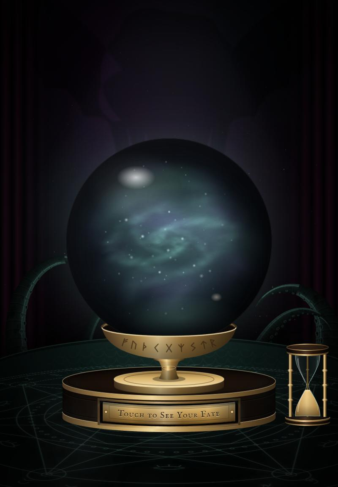
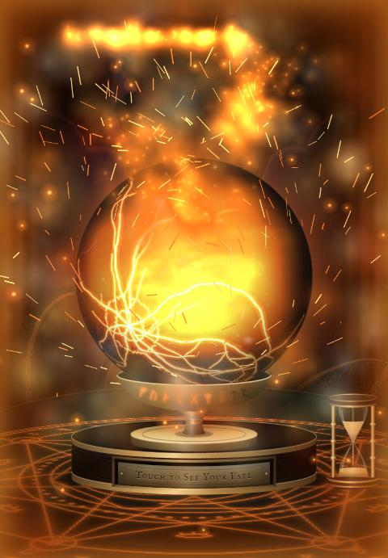
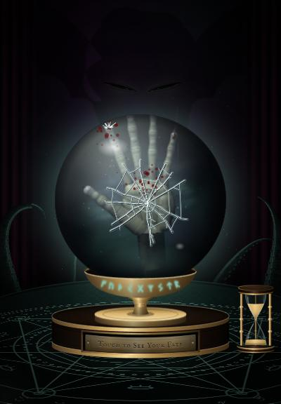

# Spooky Fate

A haunted crystal ball for Halloween. Rub the orb (or touch the brass plate) and something stirs in the glass, then
smoke rises out of it and writes your fate in the air: one of 100 genuinely horrible fates that have a sense of
humour about it.

It was built as a **set piece**: an iPad in a wooden frame on a table, running all night with nobody minding it.
Everything is one self-contained HTML file. There's nothing to install and no build step, and every image and sound is
made live in the browser.

**▶ Try it: <https://andrewbaker13.github.io/spooky-fate/>**

| The orb at rest | A roll of 20 | A roll of 13 |
|---|---|---|
|  |  |  |

## What happens

Every reveal rolls a d20 (it never says so on screen):

- **Most rolls:** the glass fills with smoke, one of ten different eyes opens inside it and looks at you, and your
  fate rises out of the orb as smoke.
- **20:** the orb bursts into flame. The glass cracks, the room catches fire, and the Old One rises behind it.
- **1:** the orb fizzles. It strains, goes *pfff*, glitches, briefly shows a dancing banana, blue-screens, and reboots
  into *Eldritch Cthulhu 95*. Then it gives you a lame fate.
- **13:** something inside wants out. A hand hammers the glass with its fist, slams it open-palmed, and drags its
  claws down the inside as it sinks away.

After each fate, the brass plate locks down and the hourglass flips. When the sand runs out, the orb is ready for the
next person.

All the sound is synthesized live with the Web Audio API: a droning room, whispers, the orb's hum, the blasts, the
glass, the screams. Browsers only allow sound after the first touch, so the first visitor's tap wakes it up.

## Address options

Add these to the end of the address. You can combine them, e.g. `?mode=lite#dev-fps`.

| Option | What it does |
|---|---|
| `?mode=full` / `?mode=lite` | Locks the full or the lighter build. Without it, the page measures the device once in its first seconds and picks for itself. Lite renders fewer pixels and particles, with no live blurs, for older devices. |
| `#dev` | Shows a test panel: force a particular fate, eye or outcome, skip the cooldown, mute, and open a **sound board** that plays every sound with a note on when it's used. |
| `#fps` | A frame-rate readout in the corner. You can also press **F**, or hold a finger on the top-left corner for 2 seconds. |
| `#nat20` / `#nat1` / `#hand` | Makes every reveal the fire, the fizzle or the hand. Use these on their own, not combined with others. |
| `#reset` | Forgets the device check and any saved "low quality" setting. Use it on its own, once. |

## Running it as a kiosk (iPad)

1. Open the address in Safari, without `#dev`. Add `?mode=full` if the device is recent.
2. Use **Share → Add to Home Screen**, and launch it from that icon. It runs full-screen.
3. **Settings → Display & Brightness → Auto-Lock → Never.** Keep it plugged in, and turn Low Power Mode off.
4. Turn on **Guided Access** (Settings → Accessibility), then triple-click the side button to lock the iPad into the
   page.
5. Leave a little air around the iPad if it's in a frame. Heat is the most likely way it slows down over a long
   night.

The page looks after itself for the rest:
- **Glitches:** it reloads itself if the animation ever stalls.
- **Fresh starts:** every few hours, at a quiet moment, it reloads to clear anything the browser has been hoarding.
  It only does this if the site is reachable, so a Wi-Fi drop won't leave a blank screen.
- **Slow devices:** it lowers its own resolution if a device can't keep up.

## Remixing

It's all in [`index.html`](index.html). Search for these:

| To change | Look for |
|---|---|
| The fates | `const FATES` (100 of them) and `const FIZZLES` (the fizzle's 20 lame ones) |
| The odds of each outcome | `roll === 20` in `reveal()` |
| How long the orb rests between fates | `COOLDOWN_MS` |
| How long a fate stays up with nobody around | `IDLE_RESET_MS` |
| The eyes | `const EYES` |
| Colours | the CSS variables at the top (`--velvet`, `--brass`, `--ecto`, …) |
| The sounds | the functions starting with `snd`, e.g. `sndSlam`, `sndDetonate`, `sndChime` |

To work on it locally, any static file server will do, e.g. `python -m http.server`. Then open
`http://localhost:8000/#dev`.

**If it's slow in your desktop browser,** check that hardware acceleration is on. In Chrome, open `chrome://gpu`; it
should say "Hardware accelerated". Everything here is drawn by the graphics card, and in software mode it crawls.

## How it's made

- Plain HTML, CSS and JavaScript in one file, with no libraries.
- Canvas 2D for the orb's smoke, the eyes, the fire, the Old One and the tentacles.
- The hand is a small software ray-caster: it computes every pixel of a posed 3D hand each frame, with lighting,
  self-shadowing and skin texture.
- The fizzle's crash screen is wrapped onto the sphere pixel by pixel.
- The plinth, the plate and the hourglass are SVG.
- Web Audio for all the sound.

## Credits

- Typefaces: *IM Fell English* and *IM Fell English SC* by Igino Marini, from Google Fonts (SIL Open Font License).
- The blue crash screen and the *Eldritch Cthulhu 95* boot screen are parody. They aren't affiliated with or endorsed
  by Microsoft, and contain none of its logos.
- The dancing banana is original pixel art made for this, in tribute to the old *Peanut Butter Jelly Time* meme.

## License

[MIT](LICENSE). Use it, change it, scare people with it.
